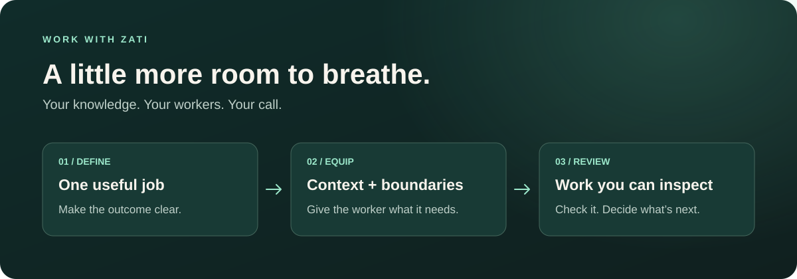

# Let Zati run it when you can’t.

Bring your knowledge and daily work together. 
Give AI workers a clear job, the right context, and boundaries you control.

**[Explore Zati →](https://zati.run)**

## Start with one useful job.

The research brief you keep postponing. The weekly update assembled from scattered notes. The draft your team needs before they can move forward.

Zati is an open-source platform for persistent AI workers. Organize their instructions, skills, tasks, and context in one place—so the work has a home beyond a single chat.

| You bring | Zati gives the work a home |
| :--- | :--- |
| **Your knowledge** | Context and instructions workers can use across tasks. |
| **Your way of working** | Configurable roles, skills, and repeatable assignments. |
| **Your boundaries** | Scoped permissions, budgets, and action reviews. |
| **Your standards** | Task history, artifacts, and evidence you can inspect. |

## More help. You stay in charge.

Start small. Define what a useful result looks like. Give a worker only the access it needs, then review what it produces before expanding its responsibility.

For builders, Zati brings a Go controller, a desktop interface, a CLI, and MCP into the same platform. For teams, the starting point is simpler: **one job worth taking off your plate.**

Zati is under active development. Available features and setup depend on the version and deployment.

### What would you like to hand off first?

**[Meet Zati at zati.run →](https://zati.run)**

Open source · Built in California

